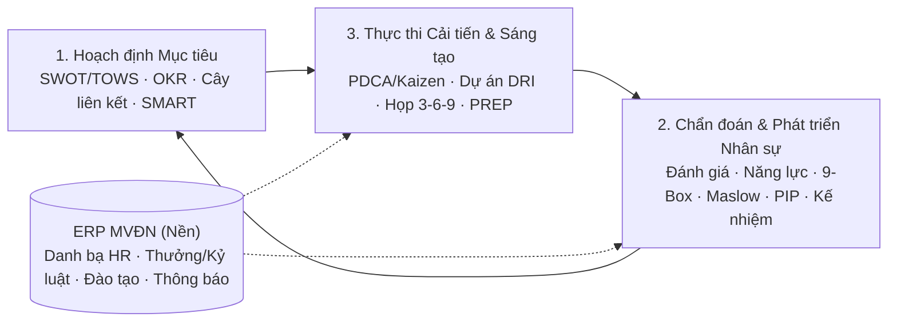

# ProCEO 3.0 — Phương án cải tạo toàn diện (Management & Talent OS)

## 1. Tái định vị cốt lõi

Sau khi tách phần **xử lý sự cố & điều độ sản xuất hiện trường** sang **ERP MVĐN**, ProCEO được tinh gọn và nâng cấp thành **Hệ điều hành Quản trị cho Cấp Quản lý & CEO**, tập trung vào **3 trụ cột**:



---

## 2. Những gì Dỡ bỏ / Tinh giản vs Giữ lại & Nâng cấp

| Nhóm | Hiện tại trong ProCEO | Hướng xử lý ở bản 3.0 |
|---|---|---|
| **Xử lý sự cố nhà máy** | `AndonBoardView`, `AndonQuickModal`, cảnh báo dừng dây chuyền | **Loại bỏ** khỏi UI & luồng chính (đã chuyển về ERP MVĐN). Chỉ giữ nút mở nhanh nếu cần chuyển hướng sang ERP. |
| **Giám sát LSX xưởng** | `ErpCommandBridgeTab` (123 LSX, máy chạy/nghỉ, tiếp nhận đơn) | **Tinh giản** thành cầu nối dữ liệu nền: đọc danh bạ `hr_personnel`/`personnel`, `hr_rewards`, `hr_disciplines`, `training_plans` và đẩy thông báo/chỉ thị/vinh danh sang ERP. Không làm màn hình điều độ xưởng. |
| **Hoạch định Mục tiêu** | `SwotTowsView`, `OkrManagementView`, `SmartGoalsView`, `CeoMission` | **Hợp nhất & Nâng cấp theo EMP**: thêm **Goal Alignment Tree** (cascade Công ty → Phòng → Nhóm → Cá nhân), **Check-in history**, tự động **rollup tiến độ** từ dưới lên. |
| **Chẩn đoán Nhân sự** | `PeopleManagementView` (Maslow 5 tầng + FFC Praise + AI chẩn đoán) | **Mở rộng toàn diện theo EMP**: Hồ sơ nhân sự 360° (gộp ERP HR + Maslow + Hiệu suất), **Khung năng lực & Skills Gap Radar**, **Kỳ đánh giá hiệu suất**, **Ma trận 9-Box**, **Calibration**, **PIP**, **Lộ trình nghề nghiệp & Kế nhiệm**, **Hiệu quả Quản lý (Manager Effectiveness)**, **1-on-1**, **Kudos/FFC**. |
| **Thực thi Cải tiến & Sáng tạo** | `ExecutiveExecutionTab` (PDCA/SOP), `ProjectTasksView` (DRI/RACI), `PrepReportsView`, Họp 3-6-9 | **Tái định hướng**: thuần cho dự án cải tiến, sáng tạo, tối ưu quy trình, nhiệm vụ chiến lược (không còn gắn lỗi máy/LSX). Thêm luồng **Ý tưởng/Đề xuất cải tiến → Sáng kiến PDCA → Tác vụ DRI → Chuẩn hóa SOP**. |
| **Nền tảng kỹ thuật** | `App.tsx` (1.380 dòng), state tập trung, định danh bằng tên chuỗi, không có router/validation/audit | **Tái cấu trúc 100%**: `react-router-dom`, feature folders, Zustand + hook Firestore có kiểm soát, Zod validators, `employeeId` thống nhất, RBAC theo cấp quản lý, `axis_audit_logs`, UI kit Clean Table chuẩn hóa. |

> [!WARNING]
> **Giấy phép AGPL-3.0**: Mã nguồn trong `EMP/` dùng giấy phép AGPL-3.0. Toàn bộ tính năng mới sẽ được **thiết kế và viết lại mới 100% theo kiến trúc ProCEO/Firebase** dựa trên ý tưởng nghiệp vụ của EMP — **không sao chép mã nguồn** từ `EMP/`.

---

## 3. Kiến trúc hệ thống ProCEO 3.0

### 3.1 Tech Stack & Nguyên tắc
- Giữ **React 19 + TypeScript + Vite + Tailwind v4 + Firebase/Firestore** (đồng bộ cùng Firebase của ERP MVĐN và sẵn sàng đóng gói Tauri v2).
- Giữ quy chuẩn từ `enterprise-app-blueprint`: `CustomDialog`, Stage Themes, Clean Table (`opacity-0 group-hover:opacity-100`), iframe print, `removeUndefinedDeep`, deferred sync khi tab ẩn.
- **Định danh thống nhất**: Mọi bản ghi mục tiêu, sáng kiến, tác vụ, đánh giá, 1-on-1, Maslow, FFC đều tham chiếu `employeeId` từ `hr_personnel`/`users` (thay vì chuỗi tên tự do), giữ `legacyName` để tương thích ngược dữ liệu cũ.
- **Phân quyền Cấp Quản lý (RBAC)**: Mở rộng từ "chỉ Admin" sang các cấp quản lý trong ERP (`CEO/Director`, `HR Manager`, `Department Manager`, `Supervisor`), lọc phạm vi dữ liệu và menu theo vai trò/phòng ban.

### 3.2 Cấu trúc thư mục mới (Feature-First)
```text
src/
├── app/                   # router.tsx (lazy routes), AppShell, AuthGuard, RoleGuard
├── shared/
│   ├── types/             # Types dùng chung (Goal, Talent, Execution, People, Audit)
│   ├── validators/        # Zod schemas kiểm tra trước khi ghi Firestore
│   ├── constants/         # Rating scale, 9-box labels, trạng thái, màu sắc
│   ├── ui/                # DataTable (Clean Table), StatusBadge, EmptyState, KpiCard, Radar/BellCurve
│   ├── lib/               # firestore wrapper, useCollection, auditLogger, removeUndefinedDeep
│   └── utils/             # dateUtils, printUtils, rollupCalculator
├── features/
│   ├── dashboard/         # Bảng điều hành Quản lý (Mục tiêu · Chẩn đoán nhanh · Quyết định)
│   ├── goals/             # Trụ cột 1: SWOT/TOWS, Mission, OKR, SMART, Alignment Tree, Check-ins
│   ├── talent/            # Trụ cột 2: Hồ sơ 360°, Đánh giá, Năng lực & Skills Gap, 9-Box, Kế nhiệm, Lộ trình, PIP, Manager Effectiveness
│   ├── engagement/        # Trụ cột 2 (gắn kết): Maslow 5 tầng, 1-on-1 Meetings, Phản hồi FFC & Kudos Wall
│   ├── execution/         # Trụ cột 3: Đề xuất Cải tiến/Sáng tạo, PDCA & SOP, Tác vụ DRI/RACI, Họp 3-6-9, Chỉ thị PREP
│   ├── insights/          # Phân tích tổng hợp hiệu suất, phân phối điểm (Bell Curve), báo cáo quản trị
│   ├── copilot/           # AI Executive Copilot (tóm tắt đánh giá, chẩn đoán nhân sự, gợi ý OKR/PDCA)
│   ├── erp-sync/          # Đọc danh bạ HR, thưởng/kỷ luật/đào tạo ERP & cầu gửi thông báo/vinh danh
│   └── settings/          # Cài đặt, thang điểm, lịch nhắc, sao lưu JSON, Audit log viewer, Sổ tay
└── main.tsx
```

---

## 4. Bản đồ tính năng theo 3 Trụ cột (Menu Sidebar mới)

| Nhóm Menu | Phân hệ | Giá trị chính cho Quản lý | Nguồn học từ EMP / Giữ từ ProCEO |
|---|---|---|---|
| **ĐIỀU HÀNH** | Bảng điều hành Quản lý | Tổng quan 3 trụ cột: Tiến độ mục tiêu, Cảnh báo nhân sự cần chú ý, Việc cải tiến đang chạy, Hộp quyết định | ProCEO Dashboard (làm gọn, bỏ widget LSX/Andon) |
| | AI Copilot | Chẩn đoán nhân sự, tóm tắt kỳ đánh giá, rà soát OKR rủi ro, gợi ý sáng kiến | ProCEO Copilot + EMP AI Summary |
| **1. HOẠCH ĐỊNH MỤC TIÊU** | Chiến lược SWOT & TOWS | Phân tích SWOT, sinh ma trận chiến lược SO/WO/ST/WT → chuyển thành Mục tiêu/Sáng kiến | Giữ nguyên ProCEO |
| | OKR & Mục tiêu SMART | Quản lý Objective, Key Results định lượng, chuẩn hóa SMART, log Check-in tiến độ | ProCEO + EMP Check-ins |
| | Cây liên kết Mục tiêu | Sơ đồ cascade Công ty → Phòng ban → Nhóm → Cá nhân, tự động tính % rollup | Mới từ EMP (`GoalAlignment`) |
| **2. CHẨN ĐOÁN NHÂN SỰ** | Hồ sơ Chẩn đoán 360° | Chọn 1 nhân viên để xem toàn cảnh: Năng lực, Động lực Maslow, Thành tích/Kỷ luật ERP, Mục tiêu đang giữ, Lịch sử 1-on-1 & FFC | Mới (Hợp nhất ProCEO + ERP + EMP) |
| | Khung năng lực & Skills Gap | Định nghĩa năng lực theo vị trí + thang hành vi; biểu đồ Radar chẩn đoán thiếu hụt kỹ năng & gợi ý đào tạo | Mới từ EMP |
| | Kỳ đánh giá & Hiệu chỉnh | Tạo kỳ đánh giá (Tháng/Quý/Năm/Thử việc), chấm điểm năng lực + mục tiêu, Bell Curve & Calibration | Mới từ EMP |
| | Ma trận 9-Box & Kế nhiệm | Kéo/đặt nhân sự trên lưới 3×3 (Hiệu suất × Tiềm năng); lập danh sách kế nhiệm vị trí chủ chốt & lộ trình thăng tiến | Mới từ EMP (`NineBox`, `Succession`, `CareerPath`) |
| | Kế hoạch cải thiện (PIP) | Theo dõi nhân sự hiệu suất thấp với mục tiêu phục hồi có thời hạn (liên kết kỷ luật ERP) | Mới từ EMP |
| | Hiệu quả Quản lý | Chấm điểm cấp quản lý dựa trên kết quả đội ngũ, tần suất 1-on-1, phản hồi FFC, hoàn thành đánh giá | Mới từ EMP (`ManagerEffectiveness`) |
| | Động lực Maslow, 1-on-1 & FFC | Coaching 1-on-1 có agenda/action item, tháp Maslow 5 tầng, khen ngợi FFC & Bảng vinh danh | Nâng cấp `PeopleManagementView` + EMP 1-on-1 & Kudos |
| **3. THỰC THI CẢI TIẾN** | Sáng kiến Cải tiến & PDCA | Quản lý ý tưởng sáng tạo, dự án cải tiến quy trình theo vòng Plan-Do-Check-Act & chuẩn hóa SOP | Nâng cấp ProCEO PDCA (bỏ gắn LSX) |
| | Nhiệm vụ DRI & RACI | Giao việc phi-vận-hành (cải tiến, dự án mới, hành động từ họp/1-on-1), 1 DRI, SLA 24h, điểm nghẽn | Nâng cấp ProCEO Tasks (bỏ gắn LSX/Andon) |
| | Họp 3-6-9 & Chỉ thị PREP | Họp điều hành 30 phút (6 bước, 9 nguyên tắc) & truyền thông/chỉ thị PREP | Giữ nguyên ProCEO |
| **HỆ THỐNG** | Phân tích & Báo cáo | Bell curve, so sánh phòng ban, tỷ lệ đạt mục tiêu, xuất/in quyết định (khen thưởng, nâng bậc, cảnh cáo) | Mới từ EMP (`Analytics`, `Letters`) |
| | Sổ tay & Cài đặt | Sổ tay phương pháp luận, Thang điểm đánh giá, Nhắc việc, Nhật ký hệ thống (`audit_logs`), Backup JSON | ProCEO + EMP Settings/Audit |

---

## 5. Mô hình dữ liệu Firestore (`axis_*`)

- **Cơ sở & Nhân sự**:
  - Đọc từ ERP: `hr_personnel`, `personnel`, `users`, `hr_rewards`, `hr_disciplines`, `training_plans`.
  - Bổ sung trên ProCEO: `axis_audit_logs` (append-only), `axis_notifications`, `axis_ai_summaries` (cache kết quả AI).
- **Trụ cột 1 — Mục tiêu**:
  - `axis_ceo_swot`, `axis_ceo_missions`, `axis_ceo_okrs`, `axis_ceo_tasks` (chuẩn hóa thêm `employeeId`, `parentId`, `level`, bỏ phụ thuộc bắt buộc vào LSX), `axis_goal_checkins`.
- **Trụ cột 2 — Chẩn đoán Nhân sự**:
  - `axis_perf_frameworks` (nhúng `competencies` & `levels`), `axis_perf_cycles`, `axis_perf_participants`, `axis_perf_reviews`, `axis_perf_potential` (dữ liệu 9-Box), `axis_talent_pips`, `axis_talent_career_paths`, `axis_talent_tracks`, `axis_talent_succession`, `axis_one_on_ones`, `axis_feedback` (hợp nhất từ `axis_ceo_praises` theo mô hình FFC + Kudos), `axis_ceo_coaching` (Maslow), `axis_talent_letters`.
- **Trụ cột 3 — Thực thi Cải tiến & Giao tiếp**:
  - `axis_ceo_initiatives`, `axis_ceo_pdca`, `axis_ceo_meetings`, `axis_ceo_prep_docs`, `axis_ceo_decisions`, `axis_ceo_schedules`.

> [!NOTE]
> Với Firestore, các mảng con gắn chặt vòng đời cha (Key Results, PIP Objectives, Competency Levels, Agenda Items) được nhúng trực tiếp trong document cha; các log tăng trưởng theo thời gian (check-ins, feedback, audit) tách collection riêng để tối ưu lượt đọc.

---

## 6. Lộ trình cải tạo từng bước (An toàn, chạy Dev kiểm thử từng pha)

| Pha | Phạm vi thực hiện | Kiểm chứng trên `localhost` |
|---|---|---|
| **P0 — Tái cấu trúc nền móng** | Thiết lập `react-router-dom`, cấu trúc feature folders, Zustand + hook `useCollection`, Zod validators, UI kit (`DataTable`, `StatusBadge`, `EmptyState`, `KpiCard`), `axis_audit_logs`. **Gỡ bỏ phân hệ Andon & màn hình giám sát LSX xưởng**, giữ lại lớp đồng bộ HR từ ERP. Chuẩn hóa ánh xạ `employeeId` từ `hr_personnel` (có dry-run + backup JSON). | Giao diện mới gọn nhẹ chạy mượt, `npm run lint` sạch, dữ liệu cũ hiển thị đầy đủ không mất mát. |
| **P1 — Trụ cột 1: Hoạch định Mục tiêu** | Nâng cấp SWOT/TOWS → OKR → SMART thành hệ thống thống nhất, bổ sung **Goal Alignment Tree** (cascade + rollup tiến độ) và **Check-in History**. | Tạo mục tiêu Công ty → Phòng ban → Cá nhân, check-in cập nhật % rollup tự động. |
| **P2 — Trụ cột 3: Thực thi Cải tiến & Sáng tạo** | Tái cấu trúc **PDCA / Sáng kiến cải tiến & sáng tạo**, **Tác vụ DRI/RACI**, **Họp 3-6-9**, **PREP**, **Decision Box** tách khỏi ngữ cảnh sự cố xưởng; kết nối action item từ họp/SWOT/OKR sang PDCA & DRI. | Tạo ý tưởng cải tiến → chuyển PDCA → giao việc DRI → đẩy thông báo sang ERP. |
| **P3 — Trụ cột 2 (Phần 1): Chẩn đoán Năng lực, Maslow & 1-on-1** | Xây dựng **Hồ sơ Chẩn đoán Nhân sự 360°**, **Khung năng lực & Skills Gap Radar**, nâng cấp **Maslow + FFC/Kudos Wall**, thêm **Họp 1-on-1** (sinh action item sang Tác vụ DRI). | Chọn 1 nhân viên bất kỳ từ ERP: thấy Radar thiếu hụt kỹ năng, Maslow, thưởng/kỷ luật ERP, 1-on-1, FFC. |
| **P4 — Trụ cột 2 (Phần 2): Đánh giá Hiệu suất & 9-Box** | Xây dựng **Kỳ đánh giá** (tổng hợp tự động từ OKR/Task + điểm năng lực), **Calibration & Bell Curve**, **Ma trận 9-Box** (Hiệu suất × Tiềm năng), **PIP**. | Chạy thử 1 kỳ đánh giá quý, đặt nhân sự lên lưới 9-Box, mở PIP cho trường hợp cần cải thiện. |
| **P5 — Nhân tài, Phân tích & AI Copilot** | Hoàn thiện **Kế nhiệm (Succession)**, **Lộ trình nghề nghiệp**, **Hiệu quả Quản lý (Manager Effectiveness)**, **Văn bản/Quyết định (in iframe)**, nâng cấp **AI Copilot** chuyên sâu cho 3 trụ cột. | Dashboard Hiệu quả quản lý & báo cáo tổng hợp chạy ổn định, `npm run lint` sạch. |

---

## 7. Chỉ cần anh/chị xác nhận 2 điểm để bắt đầu P0

1. **Quyền đăng nhập Quản lý**: Hiện tại `ErpAdminLoginGate` chỉ cho `ADMIN` và `DIRECTOR` vào. Với định vị mới là công cụ cho **các quản lý**, anh/chị có muốn mở cho các role quản lý khác trên ERP (như `PROD_MANAGER`, `HR`, Trưởng phòng) đăng nhập và phân quyền xem/giao việc theo phòng ban không?
2. **Xử lý dữ liệu Andon & ERP LSX cũ**: Ở P0, mình sẽ **gỡ khỏi giao diện & menu** phần Andon và giám sát 123 LSX (nhưng vẫn giữ nguyên các bảng Firestore không xóa dữ liệu), được chứ ạ?
